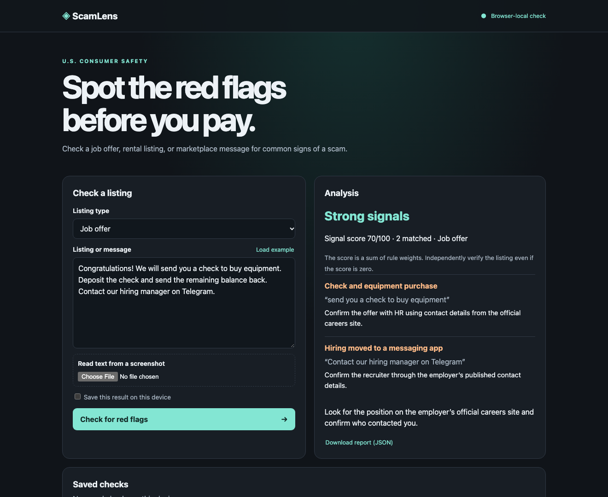
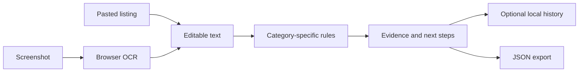

# ScamLens Scanner

ScamLens helps people in the United States review job offers, rental listings, and marketplace messages before sending money or personal information. It highlights the exact phrases that matched its rules and suggests how to verify each listing independently.

[Private demo for the project owner](https://scamlens-bao.baohnguyen.chatgpt.site/?example=job) · [Public demo deployment guide](#deploy-to-github-pages)



## Features

- Check pasted text or extract English text from a screenshot with browser-based OCR.
- Review category-specific flags, quoted evidence, and suggested next steps.
- Load synthetic examples for all three listing categories.
- Download a JSON report and optionally keep up to 20 reports on the current device.
- Run the app without accounts, API keys, a database, or metered inference.

## Architecture



`dist/` is the deployable static app. The rules and synthetic examples live in `dist/engine.mjs`. Browser interactions live in `dist/app.mjs`. The development server only serves the app files.

Each matched rule adds its weight once, and the score is capped at 100. Scores are heuristic and can miss scams or flag legitimate wording. The app analyzes English text. It does not open pasted links or verify the listing’s identity.

## Run locally

Use Node.js 22.13 or newer.

```sh
npm ci
npm run dev
```

Open [localhost:4173](http://localhost:4173/?example=job) for a preloaded demo. Copy `.env.example` to `.env` to change the port.

With Docker Compose, run `docker compose up` and open the same address. The default port binds to loopback.

## Quality checks

```sh
npm test
npm run lint
npm run format:check
```

CI runs these checks on pushes and pull requests. Run `npm run format` to apply formatting. The included examples are the seed data and also exercise the rule engine in automated tests.

## Privacy

Analysis takes place in the browser. OCR downloads its engine and English language assets from a third-party CDN. The app passes the screenshot to a browser worker for recognition. Saving is opt-in, and saved results and exported JSON can contain excerpts from the input. Use **Clear history** to delete reports stored on this device.

## Deploy to GitHub Pages

In the public repository, go to **Settings → Pages** and select **GitHub Actions** as the source. Then run **Actions → Publish GitHub Pages**. The public URL after successful deployment is `https://baong2911.github.io/ScamLens-Scanner/`. The app has no runtime API credentials to configure.

## Roadmap

- Add a larger labeled dataset and measure false positives by category.
- Test OCR, history and report export across desktop and mobile browsers.
- Prototype a browser extension that analyzes only text the user selects.

## Resources

- [FTC job scams](https://consumer.ftc.gov/articles/job-scams)
- [FTC rental listing scams](https://consumer.ftc.gov/articles/rental-listing-scams)
- [Report suspected fraud to the FTC](https://reportfraud.ftc.gov/)

## Author

Author: Bao H. Nguyen

LinkedIn: [https://www.linkedin.com/in/bao-hong-gia-nguyen/](https://www.linkedin.com/in/bao-hong-gia-nguyen/)

Licensed under the [MIT License](LICENSE).
